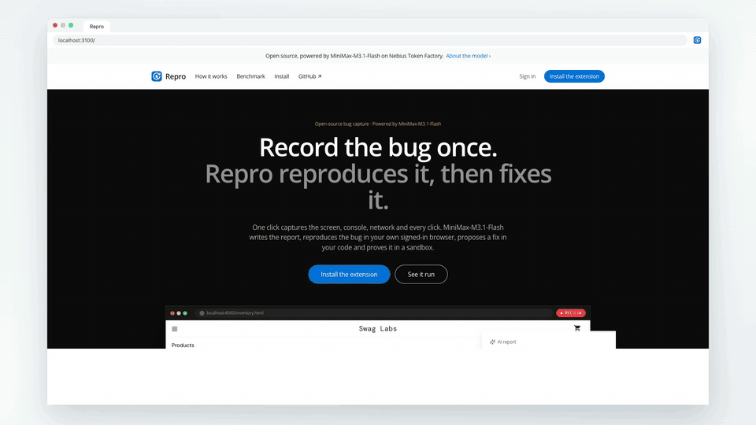
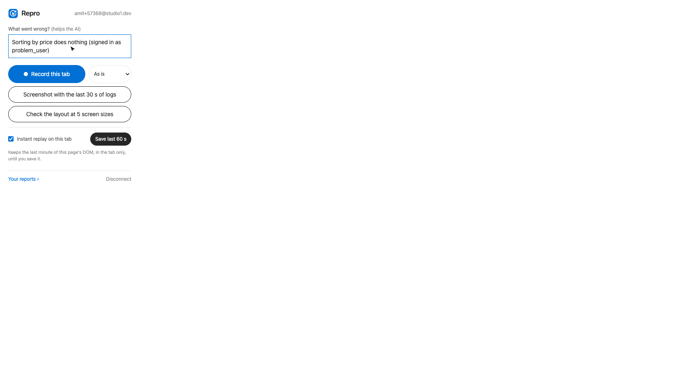
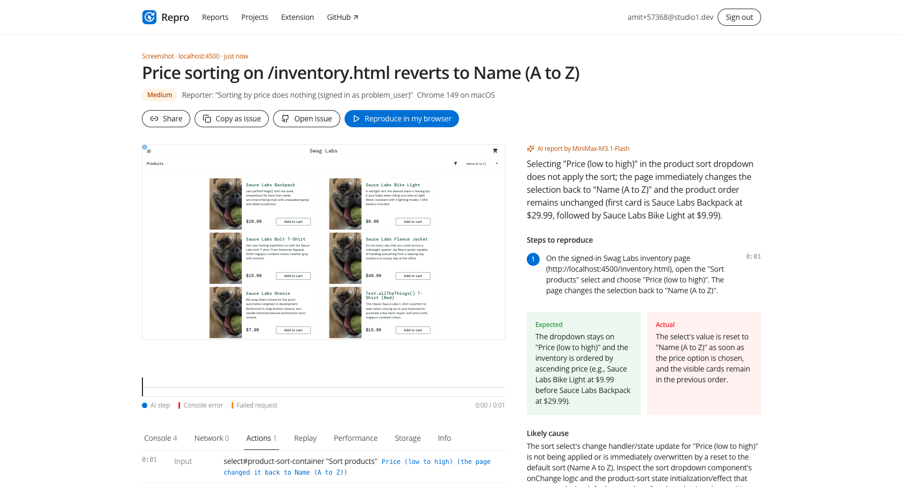
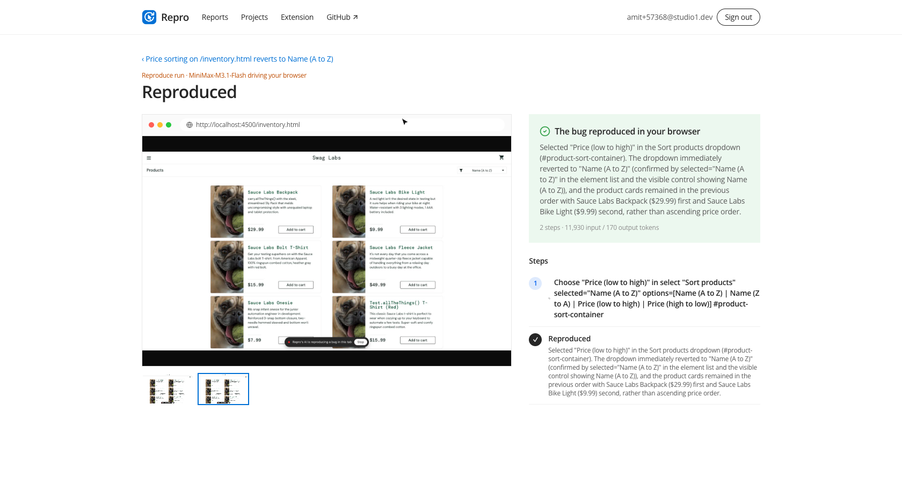
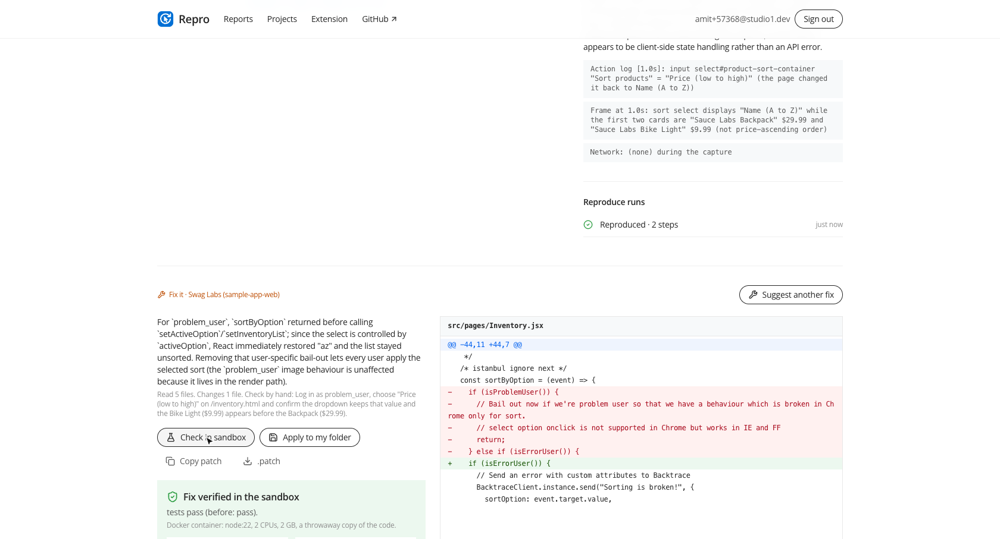
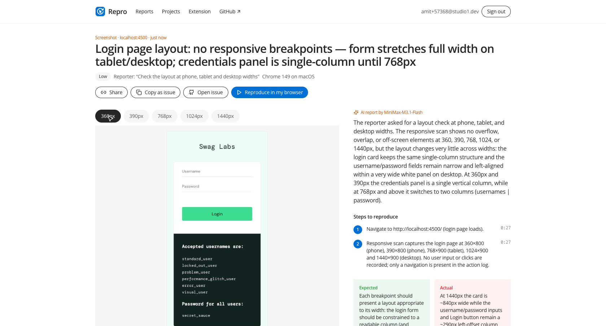
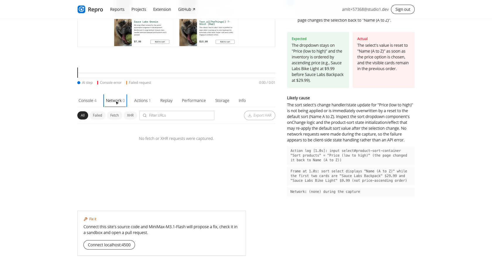

<div align="center">


# Repro

### Record the bug once. Repro reproduces it, then fixes it.

**Open-source bug capture for the browser, on an open-model stack. Record a bug with its console, network and clicks; [MiniMax-M3.1-Flash](https://tokenfactory.nebius.com/?modals=endpoint-details&model-id=MiniMaxAI/MiniMax-M3.1-Flash) writes the report, reproduces the bug in your own signed-in browser, proposes a fix in your code and checks it in a sandbox before you apply it.**

Built with [Nebius Token Factory](https://dub.sh/aistudio) on **[MiniMax-M3.1-Flash](https://tokenfactory.nebius.com/?modals=endpoint-details&model-id=MiniMaxAI/MiniMax-M3.1-Flash)** · [Get started](#get-started) · [Overview](#overview) · [Architecture](#architecture) · [Benchmark](#benchmark) · [Features](#features) · [Data and privacy](#data-and-privacy)


[](https://tokenfactory.nebius.com/?modals=endpoint-details&model-id=MiniMaxAI/MiniMax-M3.1-Flash)
[](https://dub.sh/aistudio)

[](./LICENSE)
[](https://studio1hq.com)

Run Repro on your own machine with one [Nebius Token Factory](https://tokenfactory.nebius.com) API key. The database is a SQLite file and uploads stay on disk; Docker, if it's running, gives the fix sandbox real isolation. The extension is ready to load from this repo: no build step and no store.

</div>

---

<div align="center">

<table><tr><td>

<a href="public/demo/repro-demo.mp4"></a>

</td></tr></table>

</div>

_A real session on saucedemo's open-source store ([saucelabs/sample-app-web](https://github.com/saucelabs/sample-app-web)), run locally: a broken sort saved with instant replay, the AI report, the agent reproducing it in 2 steps, a fix checked in a Docker sandbox, applied, and verified in the browser. [Watch the full recording](public/demo/repro-demo.mp4) (1 min 47 s, waiting sped up)._

## Overview

Bug reports usually arrive as "it's broken" and a blurry screenshot. Repro captures everything a developer would ask for, has an AI model turn it into a precise report, proves the bug is real by reproducing it in your browser, and then goes one step further: it proposes a fix in your code and checks it before you take it.

**A starting point you can run and extend.** Bring your own key, host it yourself and change anything. The [Features](#features) table lists what's included.

### Record

Click the Repro icon on any page and say what went wrong. Then:

- **Record this tab**: a video of the tab, optionally at an iPhone, Pixel or iPad size;
- **Screenshot**: marked up with boxes, arrows, text and blur before upload, with the last 30 seconds of logs;
- **Instant replay**: switch it on for a tab and save the last 60 seconds after the bug already happened;
- **Check the layout at 5 screen sizes**: one click, five widths, measured.

Every capture includes the console and uncaught errors with stacks, every `fetch` and XHR with headers and bodies, clicks, inputs and navigations (password fields never), performance, storage keys and device details. Secrets are stripped **before anything leaves the browser**.

<div align="center">

<table><tr><td>



</td></tr></table>

</div>

### The AI report

The report opens straight away and the analysis streams in. Frames, actions and every log line go to MiniMax-M3.1-Flash in one call. You get a title and severity, **steps pinned to timestamps** on the recording's timeline, expected versus actual, **the likely cause with the log lines that prove it**, security findings (leaked keys reported by kind and place, never by value) and, for layout scans, problems per screen width with a CSS fix.

<div align="center">

<table><tr><td>



</td></tr></table>

</div>

_The report for the broken sort in the session above._

Hand it off with **Copy as issue** (GitHub Markdown), **Open issue** (prefilled in any repo), a **Share** link, or a project **webhook** (Slack gets a formatted message).

### Reproduce in your browser

Press **Reproduce in my browser**. The extension opens a window in your own browser, so you're already signed in, and MiniMax-M3.1-Flash works through the steps: it gets a screenshot and a numbered list of the elements on screen, picks one action with a tool call (`click`, `type`, `select`, `press`, `scroll`, `navigate`, `click_at`, `done`), and the extension performs it with real input events. You watch it live; it ends with **Reproduced ✓** and the evidence, or **Not reproduced** and what happened instead.

<div align="center">

<table><tr><td>



</td></tr></table>

</div>

The safety rules are in code, not only in the prompt: the agent works only in the window it opened and only on the report's site, never types into password fields, asks you before anything that looks like pay, delete, send or transfer, and stops at 25 steps. A **Stop** button sits on the page and in the dashboard.

### Fix it, then verify it

Connect the site's code under **Projects**: a folder on your machine, or a GitHub repository. On a report, **Suggest a fix**: the model reads the code (the whole codebase in one context when it's small, through `read_file` and `search` when it isn't) and proposes a minimal change as search/replace edits, shown as a diff.

- **Check in sandbox** copies the code into a throwaway Docker container (`node:22`, 2 CPUs, 2 GB), runs your test command on the original and on the patched copy, and, when you give a start command, boots the app and runs the reproduce agent against both. A fix is **verified** when the tests pass and the agent can no longer reproduce the bug.
- **Apply to my folder** writes it (local projects); **Open pull request** commits it to a branch and opens a PR that links the report (GitHub projects).
- **Verify in my browser** runs the agent again in your browser: **Fix verified** means the bug is gone.

<div align="center">

<table><tr><td>



</td></tr></table>

</div>

_The fix for the broken sort: `sortByOption` returned early for one account, so the list never re-sorted. Checked in the Docker sandbox, applied, then verified in the browser._

Without Docker the sandbox runs as a local process on a throwaway copy, and says it isn't isolated.

### Responsive layouts

**Check the layout at 5 screen sizes** renders the page at 360, 390, 768, 1024 and 1440 px, measures horizontal overflow, elements past the viewport, clipped text, overlapping controls and tap targets under 24 px, and sends the screenshots and the measurements to the model, which confirms each problem and suggests the CSS fix. Or record at a device size, and Reproduce runs at the same size.

<div align="center">

<table><tr><td>



</td></tr></table>

</div>

### For developers: DevTools for the moment it broke

- **Console** with level filters, search and grouped repeats; **Network** with a waterfall, filters, headers and bodies, **Copy as cURL** and **Export HAR** (drop it into Chrome DevTools → Network).
- **Replay**: the page's real DOM, replayed on the timeline (rrweb). Right-click any element and **Inspect** it with your own DevTools.
- **Performance** (LCP, CLS, INP, TTFB, long tasks, JS heap) and **Storage** (localStorage, sessionStorage, cookie names).

<div align="center">

<table><tr><td>



</td></tr></table>

</div>

## Architecture


**One model, four jobs, the same code everywhere.**

1. **The report** (vision + long context + JSON). Up to 24 timestamped frames (the last 3 at full detail), the reporter's note, the action log and the logs as compact text go to `MiniMaxAI/MiniMax-M3.1-Flash` with a strict JSON schema; one repair turn if it doesn't validate. Reasoning streams to the page.
2. **The agent** (computer use). [`nextAction()`](src/server/ai/agent.ts) takes one observation and returns one validated action. The extension drives the loop over plain HTTP, so it works on serverless hosting. No third-party browser service: it's Chrome's own debugger protocol in your browser, and Playwright in the sandbox and the bench.
3. **The fix** (coding). [`proposeFix()`](src/server/ai/fix.ts) reads the code with tools, proposes search/replace edits, and the app checks each one matches exactly once before rendering the diff.
4. **The check** (sandbox). [`checkFixInSandbox()`](src/server/sandbox/check.ts) runs your tests and the agent on the original and the patched copy.

**Why frames and not video?** Token Factory serves this model with image input but not video (`pnpm smoke:nebius` checks). Frames carry what a bug report needs: in the smoke test the model found the exact frame where a total changed. If video arrives, set `AI_VIDEO_INPUT=1`.

The page code is written once: [`src/shared/page-runtime.js`](src/shared/page-runtime.js) captures logs, lists elements and measures layout in the extension, and the bench injects the same file into Playwright. The bench calls the same `analyzeReport()`, `nextAction()`, `proposeFix()` and `checkFixInSandbox()` as the app, so its numbers describe the shipped code.

## Get started

Use **Node.js 22+** and **pnpm**:

```sh
git clone https://github.com/Studio1-OSS/repro.git
cd repro
pnpm install
cp .env.example .env      # add NEBIUS_API_KEY and BETTER_AUTH_SECRET (openssl rand -base64 32)
pnpm db:migrate           # creates local.db
pnpm dev                  # http://localhost:3000
```

**Install the extension.** In Chrome open `chrome://extensions`, turn on **Developer mode**, click **Load unpacked** and choose [`extension/release/repro-extension`](extension/release/repro-extension) (or download `repro-extension.zip` from the app's **Install** page). Then open **Connect** in the app and click **Connect this browser**. The same build works with any Repro app, local or deployed. To rebuild it: `pnpm ext:release`.

**Set up the fix sandbox** (optional; reports, reproduce and fixes work without it). Install [Docker Desktop](https://www.docker.com/products/docker-desktop) and start it, then:

```sh
pnpm sandbox:setup        # pulls node:22-bookworm-slim and checks for a browser
```

No Docker? Set `SANDBOX_PROVIDER=process` and fixes are checked as a local process on a throwaway copy (not isolated). The sandbox's agent uses your installed Chrome, or Playwright's Chromium (`pnpm exec playwright-core install chromium`).

Then add your app under **Projects**:

| Field | Example | Used for |
| --- | --- | --- |
| Pages it serves | `http://localhost:3001` | matching reports to this project |
| Folder or Repository | `/path/to/storefront` or `acme/storefront` | the code the fix agent reads |
| Test command | `npm ci && npm test` | run on the original and the patched copy |
| Start command, Port | `npm ci && npm start`, `3001` | boots the app (it must listen on `$PORT`) so the agent can try the bug before and after |
| Sign-in page, test account | `/login` | apps behind a login; filled by a script, never by the model |

A sandbox check needs a test command, or a start command and port; with both, the tests must pass and the agent must no longer reproduce the bug.

| Variable | What it turns on |
| --- | --- |
| `NEBIUS_API_KEY` | **Required.** Reports, reproduce runs and fixes, via [Nebius Token Factory](https://tokenfactory.nebius.com). |
| `NEBIUS_MODEL` | Default [`MiniMaxAI/MiniMax-M3.1-Flash`](https://tokenfactory.nebius.com/?modals=endpoint-details&model-id=MiniMaxAI/MiniMax-M3.1-Flash). Check another with `pnpm smoke:nebius --model <id>`. |
| `NEBIUS_BASE_URL` | Default `https://api.tokenfactory.us-north1.nebius.com/v1/`. |
| `AI_VIDEO_INPUT` | `1` sends recordings as video instead of frames, once your provider supports it. |
| `BETTER_AUTH_SECRET`, `BETTER_AUTH_URL` | Sessions ([Better Auth](https://www.better-auth.com)); the URL is `http://localhost:3000` locally, your https URL when deployed. |
| `DATABASE_URL`, `DATABASE_AUTH_TOKEN` | `file:local.db` locally, or `libsql://…` on [Turso](https://turso.tech). |
| `CLOUDINARY_URL` | Media on [Cloudinary](https://cloudinary.com) (free plan). Unset: uploads stay in `.uploads/`. |
| `SANDBOX_PROVIDER` | `process` to skip Docker. Default: Docker when it's running. |
| `AI_CREDITS_PER_USER_PER_DAY` | Daily AI allowance per account (default 200: a report costs 2, an agent step 1, a fix 6, a sandbox check 4). |

**Check your setup:** `pnpm smoke:nebius` prints what the model supports on Token Factory. Measured on 2026-10-23:

| Check | MiniMax-M3.1-Flash on Token Factory |
| --- | --- |
| Images (JPEG/PNG/WebP, URL or data URI) | ✓ about 1,500 tokens per 1280×800 screenshot; 573 at `detail: "low"` |
| Timestamped frames | ✓ found the exact frame where the total changed |
| Video (`video_url`) | ✗ not for this model, so Repro sends frames |
| Strict JSON schema · native tool calls · streaming | ✓ · ✓ · ✓ |
| Reasoning | ✓ in `reasoning_content`; `reasoning_effort` low to high |
| Long context | ✓ a 946k-token prompt found the one failing request among ~50k log lines |

**Deploy.** Self-hosting on a machine with a disk needs nothing more: `pnpm build && pnpm start` keeps SQLite and local uploads, and the sandbox works there. On serverless hosting (Vercel), add Turso and Cloudinary (both free tiers); everything works except folder projects and the sandbox, which need a machine of your own.

## Benchmark

`pnpm bench --fix` runs the whole loop on [`bench/app`](bench/app), a small store built for the benchmark with seeded bugs whose correct behaviour is pinned by its own tests: record the bug like a user would, write the report, reproduce it in a fresh signed-in tab, propose a fix, and verify it in the sandbox (the bug's failing test passes on the patched copy, and the agent can no longer reproduce it).

| Case | Report | Cause named | Reproduced | Fix verified in sandbox |
| --- | --- | --- | --- | --- |
| A coupon makes the total `$NaN` (and a live key rides in the URL) | ✓ | ✓ (leak flagged ✓) | ✓ 4 steps | ✓ `pricing.js`, `checkout.js` |
| Saving the profile fails with a 500 but says "Saved" | ✓ | ✓ | ✓ 4 steps | ✓ `server.mjs`, `profile.js` |
| The Orders link leads to a 404 | ✓ | ✓ | ✓ 2 steps | ✓ `server.mjs` |
| Valid emails with `+` are rejected | ✓ | ✓ | ✓ 3 steps | ✓ `validate.js`, `settings.js`, `server.mjs` |
| The quantity "+" adds two | ✓ | ✓ | ✓ 2 steps | ✓ `cart.js` |
| Checkout scrolls sideways on phones (layout scan) | ✓ | ✓ | measured | ✓ `styles.css`: 0 px overflow at 360 px |
| Control: "Sign out does nothing" (it works) | – | – | ✓ said "not reproduced" | – |

`pnpm bench:real` runs the same code on **public sites built for test automation, whose bugs are in their own code**:

| Case | Site | Result |
| --- | --- | --- |
| Sorting by price does nothing | saucedemo.com (`problem_user`) | ✓ reported and reproduced |
| Every product shows the same photo | saucedemo.com (`problem_user`) | ✓ reported and reproduced |
| Add to cart throws for one product | saucedemo.com (`error_user`) | ✓ the right product named, reproduced |
| An error on page load | the-internet.herokuapp.com | ✓ reported and reproduced |
| Two broken images | the-internet.herokuapp.com | ✓ reported and reproduced |
| Misaligned product cards | saucedemo.com (`visual_user`) | ✓ layout findings at 390 and 768 px |
| Control: "I can't add a todo" (it works) | TodoMVC | ✓ "not reproduced" |

Results: [`bench/results.md`](bench/results.md) and [`bench/real-results.md`](bench/real-results.md). A report averages about 4,700 input tokens, a reproduce run about 12,800 (3 steps), and a fix with its sandbox check about 26,000 (37 s on average). At [Token Factory](https://tokenfactory.nebius.com)'s price for MiniMax-M3.1-Flash ($0.15 per 1M input tokens, $0.015 cached, $0.60 output; checked 2026-10-23) that's well under a cent each. Token Factory caches repeated prompt prefixes automatically, so agent and fix turns cost less than these totals suggest.

**What the benchmarks changed.** Each miss became a product fix, not a prompt tweak for the test:

- The agent couldn't operate `<select>` dropdowns → a `select` tool, with each dropdown's options in the element list.
- Six identical "Add to cart" buttons made the report name the wrong product → captures and the element list now carry each control's `id` or `data-test`.
- When an app puts a control's old value back (the bug, in saucedemo's case), capture and the agent now say so instead of retrying 25 times.
- A redacted secret looked harmless to the model → redaction records what it removed and where, so leaks are still reported.
- The agent once signed in with a password shown on a page → password fields are blocked in code.
- The fix agent looped on one search in a real codebase → a repeated-call guard and a "propose now" turn.

**What's been verified.** All of the above ran on 2026-10-23 against the live endpoint, along with `pnpm e2e` (the real extension in Chromium: pair, annotated screenshot, report, reproduce, project, fix, sandbox, apply, verify, instant replay, layout scan) and the recorded session at the top. Latency varies with the endpoint: reports took 6 to 30 seconds across runs. Not yet exercised against a live GitHub repository: opening pull requests (covered by unit tests with a mocked API).

## Data and privacy

Reports, runs, fixes and projects live in SQLite (a local file or Turso). Recordings, frames, DOM snapshots and replays are on local disk or in your Cloudinary account, at long random URLs.

- The capture script keeps the last 30 seconds of console and network activity **inside the tab**; nothing is sent until you report. Instant replay is off until you switch it on for a tab.
- Before upload, cookies, auth headers, API keys, JWTs and `password`/`token`/`secret` parameters become typed placeholders, and password fields are never captured. The server redacts again.
- `chrome.debugger` is attached only during Reproduce (to the window the agent opened), device-size recording and layout scans. Chrome shows its banner while it is.
- A project's GitHub token and test-account password are encrypted at rest (AES-256-GCM). The sandbox signs in with a script; the model never sees or types a password.

Nothing leaves your server except calls to the services you configure: **Nebius Token Factory** (frames, redacted logs, your note, screenshots and element lists during runs, and the source files the fix agent reads), **Cloudinary** if configured, **GitHub** for projects that use it, and a project's **webhook**. Repro sends no telemetry of its own.

## Features

| Area | Included |
| --- | --- |
| Capture | Tab recording (optionally at a device size), annotated screenshots, instant replay of the last 60 s, 5-width layout scan; console, network with bodies, actions, performance, storage, DOM |
| AI report | Title, severity, timestamped steps, expected vs actual, likely cause with evidence, security findings, layout findings, live reasoning |
| Reproduce | In your signed-in browser, live view, Stop, confirmation before risky clicks, no passwords, same device size as the recording |
| Fix | Local folder or GitHub, whole-repo or tool-based reading, validated search/replace edits, diff, apply or pull request |
| Verify | Docker sandbox (tests + agent before and after), then the agent again in your browser |
| Developers | Console and network panels, Copy as cURL, HAR export, inspectable DOM replay, performance, storage |
| Hand-off | GitHub issue (copy or open), share links, webhooks with Slack formatting |
| Accounts and limits | Email and password, per-device extension pairing, daily AI credits |
| Extension | Manifest V3, prebuilt in the repo, works with any Repro deployment, store-ready |

### Extending it

- Linear and Jira alongside GitHub issues.
- A hosted sandbox provider (for example E2B) for deployments without Docker.
- Teams and shared workspaces.
- Recording links for people without the extension.
- An MCP server so coding agents can read Repro reports.

## Project layout

- `src/shared/`: schemas, redaction, HAR and cURL, log building, and the in-page runtime (app, extension and bench).
- `src/server/ai/`: the Nebius adapter, the report, the reproduce agent and the fix agent.
- `src/server/sandbox/`, `src/server/source/`, `src/server/browser/`: the sandbox, code sources (local, GitHub) and the server-side browser.
- `src/app/`, `src/components/`: the web app.
- `extension/`: the WXT extension; `extension/release/repro-extension` is the prebuilt build.
- `bench/`: the benchmark app and runner, real-site runs, results.
- `e2e/`, `scripts/`: the end-to-end test, the smoke test, the demo recorder, release and icon scripts.

## Contributing

Issues and pull requests are welcome. Run `pnpm test && pnpm typecheck && pnpm ext:typecheck` before sending one; changes to prompts or the agent should come with a `pnpm bench` run. [AGENTS.md](AGENTS.md) has the conventions.

## License

[MIT](LICENSE) © 2026 Studio1HQ
